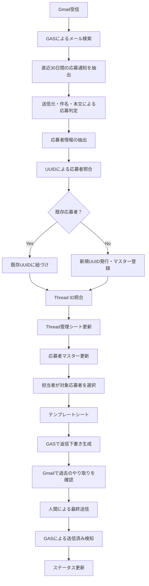
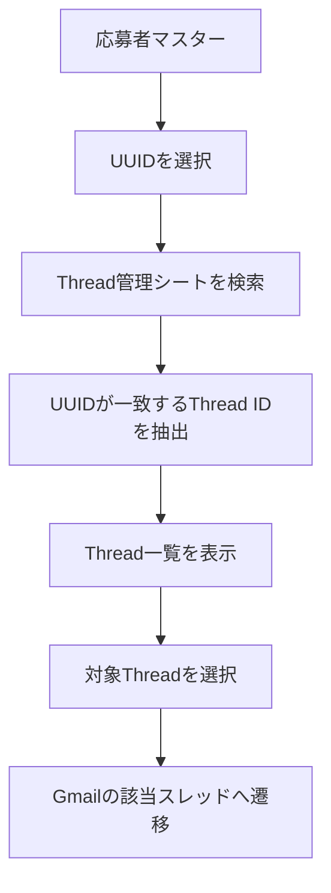
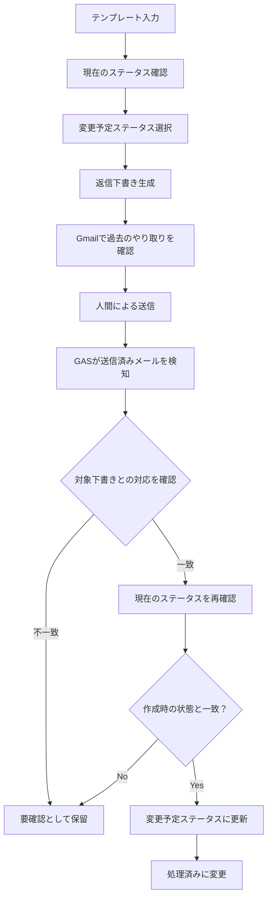
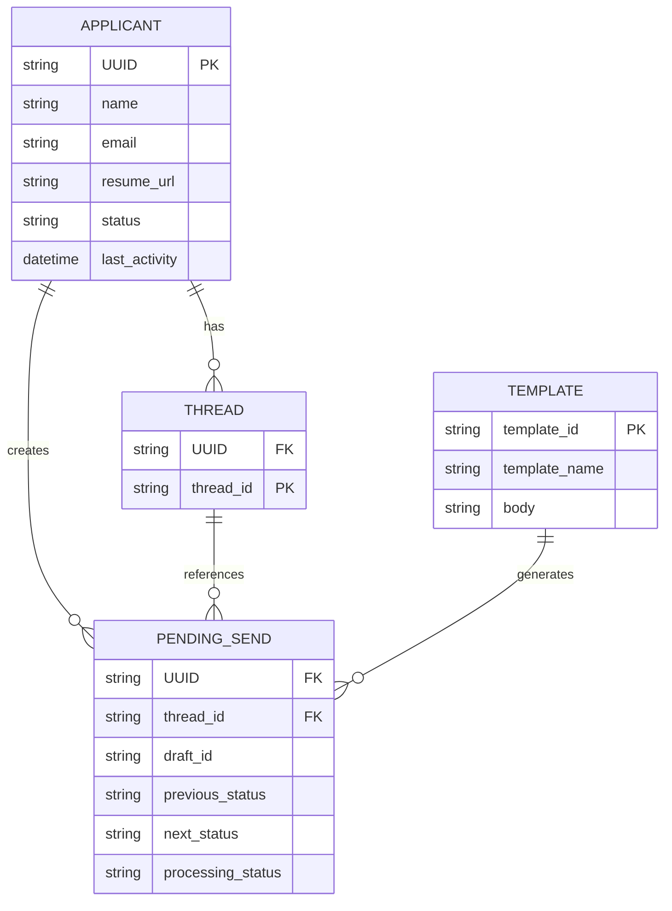
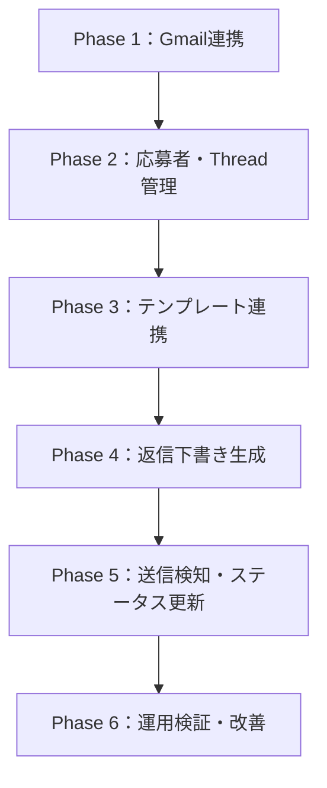

# 採用管理・メール自動化システム

## System Design Document

\!Status \!Version \!Platform \!Language

| 項目 | 内容 |
| --- | --- |
| **Version** | 3.0 |
| **Platform** | Google Workspace |
| **Technology** | Google Apps Script / Google Sheets / Gmail |
| **Status** | Design Phase |

---

## Table of Contents

- 1\. 開発背景とコアコンセプト
  - 1.1 開発動機
  - 1.2 コアバリュー
  - 1.3 基本設計思想
- 2\. システム概要とデータフロー
  - 2.1 システム構成
  - 2.2 全体データフロー
- 3\. スプレッドシート構成
  - 3.1 応募者マスター
  - 3.2 Thread管理シート
  - 3.3 テンプレートシート
  - 3.4 取得設定シート
  - 3.5 送信待ち管理
- 4\. コア機能設計
  - 4.1 応募通知の取得・応募者登録
  - 4.2 Thread管理・照合
  - 4.3 担当者情報の自動取得
  - 4.4 Gmail返信下書き生成
  - 4.5 ステータス管理
- 5\. Human-in-the-Loop
- 6\. データ構造
  - 6.1 エンティティ間の関係
  - 6.2 データ管理上の原則
- 7\. 初期実装での割り切り
- 8\. 将来的な拡張
- 9\. 実装ロードマップ
- 10\. セキュリティ・運用上の考慮事項
- 11\. まとめ

---

# 1\. 開発背景とコアコンセプト

## 1.1 開発動機

自身の就職活動を進める中で、同一企業から届くメールの担当者名が毎回異なっていることに着目した。

複数の担当者が応募者対応を行う場合、以下のような課題が発生すると考えた。

- 対応履歴や進捗状況の把握が困難
- メール文面や対応品質の不統一
- 担当者間の情報共有コスト
- 定型的なメール作成業務の繰り返し
- 選考ステータスの更新漏れ

こうした課題に対し、採用プロセスにおけるメール対応を標準化し、複数人で運用しても一貫した応募者対応を実現できる仕組みを構想した。

## 1.2 コアバリュー

> **「誰が操作しても迷わず、一貫した応募者対応を実現できる仕組み」**

本システムでは、以下の実現を目指す。

- メール作成業務の定型化
- 操作担当者の自動取得と署名への反映
- Gmailの既存スレッドに紐づく返信下書きの生成
- 応募者情報とメールスレッドの一元管理
- 選考ステータスの管理と更新支援
- 人間による最終確認を前提とした安全な自動化

## 1.3 基本設計思想

本システムでは、すべての業務を自動化することを目的としない。

採用業務におけるイレギュラーな対応や最終的な判断は人間に委ね、定型業務の効率化と標準化に重点を置く。

特に、メールの送信操作と過去のやり取りの確認は人間が実施する。

自動化する範囲と人間が判断する範囲を明確に分離することを基本方針とする。

---

# 2\. システム概要とデータフロー

## 2.1 システム構成

本システムは、Google Workspaceを活用した軽量なインハウス型採用管理・メール自動化ツールである。

### 使用技術

| 技術 | 用途 |
| --- | --- |
| Gmail | 応募者とのメール対応 |
| Google Sheets | 応募者・Thread・ステータス管理 |
| Google Apps Script | メール取得・データ処理・下書き生成 |
| Gmail API / Apps Script Gmail Service | Gmailとの連携 |
| Google Drive | 履歴書などのファイル参照 |

## 2.2 全体データフロー

mermaid



---

# 3\. スプレッドシート構成

本システムでは、応募者マスターを中心とした複数シート構成を採用する。

応募者ごとに個別のシートを生成する方式は採用せず、共通の管理シートに集約する。

## 3.1 応募者マスター

システムの中心となる管理シート。

1応募者につき1レコードを保持する。

### 管理項目

| UUID | 応募者名 | メールアドレス | 履歴書 | ステータス | 最終活動日 |
| --- | --- | --- | --- | --- | --- |
| A001 | 山田太郎 | yamada@example.com | PDF | 面談調整中 | 2026/11/04 |
| A002 | 佐藤次郎 | sato@example.com | PDF | 新規受付 | 2026/11/03 |
| A003 | 鈴木花子 | suzuki@example.com | PDF | 書類通過 | 2026/11/02 |

| 項目 | 説明 |
| --- | --- |
| UUID | 応募者を識別する一意ID |
| 応募者名 | 氏名 |
| メールアドレス | 応募者のメールアドレス |
| 履歴書 | PDFファイルへのリンク |
| ステータス | 現在の選考状況 |
| 最終活動日 | 最後に確認された関連メールの日時 |

### UI設計

シート上部には各種テンプレートへのジャンプリンクを常設する。

- 書類通過メール
- 面接日程調整メール
- 不採用通知
- その他の定型連絡

また、Thread管理シートへの導線を設ける。

UUIDを選択して専用の操作ボタンを押すことで、該当応募者のThread一覧を表示できるようにする。

### ステータス選択肢

初期実装では以下の固定プリセットを使用する。

1. 新規受付
2. 書類通過
3. 面談調整中
4. 不採用
5. 内定

> **Note:** 同一応募者が複数職種に応募する場合、将来的には応募案件単位でステータスを分離できる構造への拡張を想定する。

## 3.2 Thread管理シート

応募者とGmailのメールスレッドを紐づけるための専用シート。

UUIDとThread IDの1対多関係を管理する。

### 管理項目

| UUID | Thread ID |
| --- | --- |
| A001 | thread\_001 |
| A002 | thread\_002 |
| A001 | thread\_003 |
| A003 | thread\_004 |
| A001 | thread\_005 |

### 設計方針

- 1つのUUIDに複数のThread IDを紐づけられる。
- 新しいThread IDは常に最終行に追加する。
- 登録時に既存UUIDの最終行を検索する必要はない。
- 必要なときにUUIDを条件として検索・抽出する。
- Thread IDの重複登録を防止する。
- 行の並び順には依存しない。

### データ参照の流れ

mermaid



### Gmailへの直接遷移

Thread IDからGmailの該当スレッドを開くためのリンクを生成する。

URL形式の例：

text

```text
https://mail.google.com/mail/u/0/#all/THREAD_ID
```

実装時には、対象アカウントやGmailの画面構成に合わせてURLの動作を検証する。

これにより、以下の操作導線を実現する。

**応募者マスター → Thread一覧 → Gmailの会話**

## 3.3 テンプレートシート

メールの種類ごとに共通テンプレートを用意する。

応募者ごとに個別シートを生成する方式は採用せず、共通テンプレートに対象者の情報を流し込む。

### 主な管理項目

- 対象UUID
- 応募者名
- メールアドレス
- 対象Thread ID
- 候補日時などの可変情報
- 操作担当者名
- 現在のステータス
- 変更予定ステータス
- メール本文プレビュー

### 操作イメージ

1. マスターシートから応募者を選択。
2. 使用するテンプレートを選択。
3. 応募者情報をテンプレートに反映。
4. 日程などの必要情報を入力。
5. 変更予定ステータスを選択。
6. 返信下書き生成ボタンを実行。

## 3.4 取得設定シート

求人媒体ごとの応募通知を識別するための設定シート。

### 管理項目

| 媒体名 | 送信元 | 件名キーワード |
| --- | --- | --- |
| Indeed | 通知元アドレス | 応募 |
| 求人媒体B | 通知元アドレス | エントリー |
| 求人媒体C | 通知元アドレス | 応募者 |

### 設計方針

- 企業が契約している求人媒体に応じて設定する。
- 送信元アドレスと件名キーワードを組み合わせて検索する。
- キーワードだけで応募通知を判定しない。
- 無関係なメールの取得を極力防止する。
- 実際の通知メールをサンプルとして検索条件を検証する。

## 3.5 送信待ち管理

下書きと実際の送信イベントを紐づけるための内部管理領域。

### 管理項目

| 項目 | 内容 |
| --- | --- |
| UUID | 対象応募者 |
| Thread ID | 対象スレッド |
| Draft ID | 作成した下書きの識別情報 |
| 送信予定ステータス | 送信後に反映する状態 |
| 作成時ステータス | 下書き作成時点の状態 |
| 処理状態 | 送信待ち・処理済み・要確認 |

下書きを作成しただけではステータスを変更しない。

送信済みメールとの対応関係を確認できた段階で、ステータス更新を実施する。

---

# 4\. コア機能設計

## 4.1 応募通知の取得・応募者登録

Gmailから無条件にメールを取得するのではなく、応募通知を起点とした取得方式を採用する。

### 取得条件

- 直近30日以内のメール
- 求人媒体ごとに設定された送信元
- 件名に含まれる応募関連キーワード
- 必要に応じて本文による追加判定

### Gmail検索の例

text

```text
newer_than:30d {subject:応募 subject:エントリー}
```

送信元を指定する場合：

text

```text
newer_than:30d from:notification@example.com
```

> **Note:** 上記は検索条件の例。実際の送信元・件名は利用企業の通知設定に合わせる。

### 取得処理

1. Gmailから直近30日間の対象メールを検索。
2. 送信元と件名を確認。
3. 応募通知と判断できるメールを抽出。
4. 応募者名・メールアドレスなどを取得。
5. メールアドレスを基準に既存応募者を検索。
6. 既存UUIDがあれば再利用。
7. 新規応募者ならUUIDを発行。
8. Thread IDをThread管理シートに登録。
9. マスターシートを更新。

### UUIDとThread IDの役割

| 識別子 | 役割 |
| --- | --- |
| UUID | 応募者レコードの識別 |
| Thread ID | Gmailの会話単位の識別 |

メールアドレスは応募者の照合に利用するが、複数職種への応募や同一人物の複数選考については、将来的な応募案件単位の管理を考慮する。

### 取得期間

初期実装では直近30日間の再検索方式を採用する。

| 項目 | 方針 |
| --- | --- |
| 初回取得 | 直近30日間 |
| 定期同期 | 直近30日間を再検索 |
| 既存データ | UUID・Thread IDで照合 |
| 重複登録 | 防止 |
| 30日以前の応募者 | 最終活動日などを基準にアーカイブを検討 |

> **Important:** 30日はメールの検索対象期間であり、必ずしもデータの保存期間を意味しない。

## 4.2 Thread管理・照合

応募通知のスレッドと応募者との実際の連絡スレッドが、必ずしも同一とは限らない。

そのため、応募通知を起点に応募者を登録した後、実際の連絡スレッドを別途識別して紐づける。

### 照合の基本方針

1. 既存Thread IDとの一致を確認。
2. 一致した場合は既存UUIDを再利用。
3. 新規Thread IDの場合は送信者・受信者のメールアドレスを確認。
4. 既存応募者との関連性を確認。
5. 判断できない場合は人間による確認対象とする。

メールアドレスだけで無条件に紐づけることは避け、誤登録を防止する。

## 4.3 担当者情報の自動取得

GASの `Session.getActiveUser().getEmail()` を利用して操作者を特定する。

取得したGoogleアカウントを担当者情報と照合し、署名や本文に担当者名を反映する。

取得できない場合に備え、担当者選択によるフォールバックを用意する。

## 4.4 Gmail返信下書き生成

テンプレートシートからGASを実行し、対象Thread IDに対する返信下書きを生成する。

通常の新規メール作成ではなく、既存のメール会話に紐づく返信下書きを作成する。

これにより、別スレッドへの分裂やコピペによる誤送信リスクを低減する。

## 4.5 ステータス管理

テンプレートシート上で現在のステータスと変更予定ステータスを管理する。

### 管理項目

| 項目 | 内容 |
| --- | --- |
| 現在のステータス | 現在の選考状況 |
| 変更予定ステータス | 送信後に反映する状態 |

### 処理フロー

mermaid



送信検知は時間主導型トリガーなどを利用する。

GASが人間の送信操作を直接検知するわけではないため、送信済みメールと作成済み下書きの対応関係を確認する必要がある。

また、同一イベントの二重処理を防止する。

---

# 5\. Human-in-the-Loop

本システムの最も重要な設計思想。

メールの作成や情報整理は自動化するが、最終的な判断と送信は人間が実施する。

特にGmail上で過去のやり取りを確認する工程を省略しない。

## 役割分担

| 自動化する業務 | 人間が行う業務 |
| --- | --- |
| 応募通知の取得 | 応募者への対応判断 |
| 応募者情報の整理 | 選考結果の判断 |
| テンプレート適用 | 日程・条件の確認 |
| 担当者名の差し込み | 過去の会話との文脈確認 |
| 返信下書き生成 | 最終送信操作 |
| 送信済みメールの検知 | 例外処理・判断 |

## 基本原則

> システムは担当者の判断を代替するのではなく、判断に必要な情報を整理し、定型作業を削減する。

---

# 6\. データ構造

## 6.1 エンティティ間の関係

mermaid



> **Note:** 概念的なデータモデル。実際のGoogle Sheetsでは各エンティティをシートとして管理する。

## 6.2 データ管理上の原則

- UUIDは応募者を識別する主キーとする。
- Thread IDはGmailの会話を識別する。
- メールアドレスは応募者照合に利用する。
- 履歴書の詳細情報はマスターに重複保存せず、原本へのリンクを保持する。
- ステータスは実際の送信を確認してから更新する。
- 送信待ち情報は二重処理を防止できる形で管理する。

---

# 7\. 初期実装での割り切り

最初からすべての機能を実装せず、業務上の効果が大きい機能から構築する。

| 項目 | 初期実装方針 |
| --- | --- |
| 同時編集 | 基本的に業務分担で回避 |
| 排他制御 | 最低限の事前ステータス確認 |
| メール同期 | 直近30日間の再検索 |
| Thread管理 | 専用シートでUUIDとThread IDを管理 |
| 応募通知取得 | 送信元・件名キーワードで絞り込み |
| 操作ログ | Google Workspace標準機能を活用 |
| 選考フロー | 固定プリセット |
| メール送信 | Gmailで人間が実施 |
| ステータス更新 | 送信検知後にGASで反映 |

---

# 8\. 将来的な拡張

初期実装後、以下の機能拡張を想定する。

- GmailアドオンによるGmail画面上でのステータス操作
- 企業ごとの選考フロープリセット
- 応募案件単位のステータス管理
- Gmail API Historyによる効率的な変更検知
- 複数担当者の同時操作に対する排他制御
- 操作ログの独自管理
- 求人媒体ごとの応募通知解析機能の拡充

---

# 9\. 実装ロードマップ

mermaid



## Phase 1：Gmail連携

- Gmail検索条件の設計
- 応募通知の取得
- 求人媒体ごとの検索条件検証

## Phase 2：応募者・Thread管理

- UUID発行
- 応募者マスター登録
- Thread IDの照合・登録
- Thread一覧の表示
- Gmailへの直接遷移

## Phase 3：テンプレート連携

- テンプレート作成
- 応募者情報の自動反映
- 担当者情報の取得
- ステータス変更予定の入力

## Phase 4：返信下書き生成

- 対象Thread IDの取得
- Gmail返信下書きの生成
- 宛先・本文・署名の確認

## Phase 5：送信検知・ステータス更新

- 下書き識別情報の管理
- 送信済みメールの検知
- ステータス整合性確認
- 二重処理防止

## Phase 6：運用検証・改善

- 複数応募者での動作検証
- 複数Threadでの動作検証
- 複数担当者を想定した検証
- 誤紐づけ・重複登録の検証
- GAS実行時間の検証

---

# 10\. セキュリティ・運用上の考慮事項

採用業務では履歴書などの個人情報を扱うため、以下を考慮する。

### アクセス・権限管理

- スプレッドシート・Driveのアクセス権限管理
- 履歴書PDFの共有範囲の制限
- GAS実行ユーザーの権限管理
- 担当者の異動・退職時のアクセス権解除

### データ管理

- 個人情報の保存期間と削除手順
- 操作対象データの整合性確認
- 誤更新時の復旧手順

### メール送信の安全性

- 送信対象・宛先・スレッドの確認
- 誤送信・誤更新への対応手順
- 人間による送信前の最終確認

また、GASには実行時間やサービス利用上の制限があるため、取得件数や検索処理の負荷を検証する。

---

# 11\. まとめ

本システムは、Google Workspaceを活用して採用業務におけるメール対応の標準化と効率化を実現することを目的とする。

応募者情報とメールスレッドを分離して管理し、UUIDによって両者を関連付けることで、複数のメール会話を整理できる構造を採用した。

また、求人媒体からの応募通知を起点に取得対象を絞り、無関係なメールの取り込みを防止する。

メール作成・情報整理・送信後のステータス更新はシステムが支援する一方、過去のやり取りの確認と最終送信は人間が実施する。

> **本システムの本質は、単なるメール自動化ではなく、複数人で採用業務を行う際の対応品質と業務の連続性を維持することにある。**


GitHubにそのまま貼れるMarkdown形式に整えたよ。

文章作成

# MVP：初期実装機能

本システムでは、採用業務におけるメール対応の効率化と標準化を優先し、以下の5つの機能を初期実装の対象とする。

## 1\. 応募通知の取得

- Gmailから求人媒体の応募通知を取得する。

## 2\. 応募者情報の管理

- UUIDによる応募者管理。
- Thread IDとの紐づけ。
- 応募者ごとのThread一覧表示。

## 3\. メールスレッドへのアクセス

- Gmailの該当スレッドへの直接遷移。

## 4\. メール返信の効率化

- 共通テンプレートの利用。
- 担当者名の自動取得。
- 既存Threadへの返信下書き生成。

## 5\. 選考ステータス管理

- **メール送信時：** テンプレートに設定されたステータス遷移を利用し、メール送信後にステータスを更新する。
- **メール受信時：** 返信内容などを確認し、ステータス変更が必要な場合は担当者が手動で更新する。

実装する際にはまずMVPを20時間で作り、定着度合いを見ながら現場に合わせた設計を拡張していく。
---

### 初期実装の基本方針
- テンプレを簡単に作れるスプシ×GASのシステム
- 応募者マスターデータを作ってステータス欄を持たせて、複数人の人事担当者で横断的かつ一覧性を以って扱えるシステム（ステータス欄の右に想定される次のテンプレを随時配置するシステム）
- マスターデータのthreadをクリックしたらgmailを展開して該当threadを表示できるようにする。
Document Version: 3.0 | Status: Design Phase
